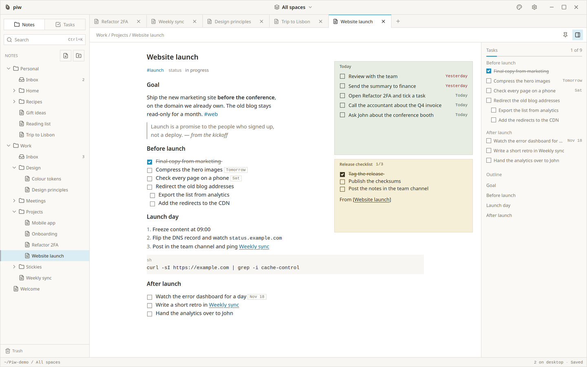

<p align="center">
  
</p>

<h1 align="center">Piw</h1>

<p align="center">
  <a href="https://github.com/mnml-tools/piw/actions/workflows/rust.yml"></a>
  <a href="https://github.com/mnml-tools/piw/actions/workflows/desktop.yml"></a>
</p>

<p align="center">
  Minimal, local-first notes and tasks for the desktop, in plain Markdown files.
</p>

Piw keeps your notes as Markdown files in a folder of your choice, finds the tasks inside them,
and puts the notes you need right now on your desktop as sticky notes. It's built with Tauri,
React, TypeScript, and Rust; the files are yours, readable by any editor.

<picture>
  <source media="(prefers-color-scheme: dark)" srcset="docs/piw-screenshot-dark.png">
  <source media="(prefers-color-scheme: light)" srcset="docs/piw-screenshot-light.png">
  
</picture>

View screenshots in [light mode](docs/piw-screenshot-light.png) or [dark mode](docs/piw-screenshot-dark.png).

> [!NOTE]
> Piw is pre-release. It runs daily on Linux with KDE Plasma. Windows and macOS build in CI but
> have not been tested by hand yet. See [Platform support](#platform-support).

## What you can do

- **Write in plain Markdown.** Notes are `.md` files in your vault (`~/Piw` by default, or any
  folder in Settings › Data). One live editor shows headings, emphasis, code and lists as you
  type, with the markers only on the line you are editing. Link notes with `[[Note]]` (renaming
  a note updates the links), tag them with `#tag`, and edit them in any other app: Piw follows.
- **Organise with folders.** The sidebar shows the vault as a tree; the top-level folders are
  spaces, and the space filter in the title bar narrows the tree, search and tasks to one of
  them. Notes, task views, Trash and Settings open as tabs.
- **Keep tasks where they belong.** A task is a `- [ ]` line in any note. Type `@tomorrow`,
  `@friday` or a date (or press `Ctrl+D`) to give it a due date, shown as a chip and kept as
  plain text in the note. The panel beside a note lists its tasks and outline, and Today,
  Upcoming and All collect the tasks of every note.
- **Capture** from any app with `Ctrl+Shift+Space` (`⌘⇧Space` on macOS), type, then
  `Ctrl+Enter`: the note or task lands in the chosen space's `Inbox.md`. The popup closes only
  after it is saved, and a draft survives an accidental close. The tray menu and
  `piw --quick-note` / `piw --quick-task` open it too.
- **Pin stickies** to your desktop for a note or a task view, each in its own colour. Select text
  in a note and choose **Create sticky from selection** to turn it into a new, linked note on
  your desktop. Keep stickies on top or hide them without losing them; position and size are
  remembered.
- **Search** every note with `Ctrl+K`, with highlighted matches.
- **Bring Piw 0.1 along.** Its notes, documents, sections and tasks are imported into the vault
  the first time; the old database is left untouched.
- **Make it yours** with System, Light or Dark mode, five accent colours, three text sizes, a
  configurable global shortcut with conflict detection, close to tray, and start at login (off by
  default).
- **Keep it yours.** No account, no cloud, no telemetry, no network requests. Back up or sync the
  vault like any folder.

On macOS use `⌘` instead of `Ctrl`. Closing the window keeps Piw in the tray; **Quit Piw** in the
tray menu exits. Every shortcut is listed in the
[design system](docs/ui-design-system.md#14-keyboard). The file format is specified in
[docs/vault-format.md](docs/vault-format.md).

## Run locally

Install Node.js 22 or later, pnpm 11 (`corepack enable`), Rust 1.90 or later, and the
[Tauri prerequisites](https://v2.tauri.app/start/prerequisites/) for your operating system. On
Debian or Ubuntu:

```sh
sudo apt install libwebkit2gtk-4.1-dev libayatana-appindicator3-dev librsvg2-dev libxdo-dev libssl-dev
```

From the project root, run:

```sh
pnpm install
pnpm tauri dev
```

Set `PIW_DATA_DIR=/some/folder` to keep your real notes out of reach while you test: Piw then
keeps its settings there and opens `/some/folder/vault` (or the folder in `PIW_VAULT`).

Use `pnpm dev` to preview the interface in a browser at <http://localhost:1420>. Outside Tauri,
an in-memory mock with a small sample vault answers every command; it is dev-only and resets on reload. Its
URL parameters are listed in the [architecture guide](docs/architecture.md#browser-preview).

## Build desktop packages

Every build regenerates the third-party licence notices and ships them inside the package.
Packages land in `src-tauri/target/release/bundle/` (or under the target triple for macOS).

### Linux

```sh
pnpm install
pnpm tauri build --bundles deb,rpm,appimage
```

The packages also install a hidden `app.piw.Piw.desktop` entry, which the Wayland shortcut portal
needs to recognise Piw. An AppImage that is not integrated into the desktop has no such entry, so
bind `piw --quick-note` to a key there. Packages are not signed; publish checksums with them.

### macOS

On a Mac with Xcode 26 or newer selected with `xcode-select`, run:

```sh
rustup target add aarch64-apple-darwin x86_64-apple-darwin
pnpm install
pnpm tauri build --target universal-apple-darwin --bundles app,dmg
```

This produces a universal **App** in `src-tauri/target/universal-apple-darwin/release/bundle/macos/`
and a **DMG** in `.../bundle/dmg/`. The app is not Developer ID signed or notarised, so Gatekeeper
blocks it on first open: right-click › Open, or run `xattr -dr com.apple.quarantine Piw.app`. For
public distribution, see [Tauri's macOS signing guide](https://v2.tauri.app/distribute/sign/macos/).

### Windows

```sh
pnpm install
pnpm tauri build --bundles nsis,msi
```

The NSIS installer and the MSI land in `bundle/nsis/` and `bundle/msi/`. They are not signed, so
SmartScreen warns on first run (More info › Run anyway). If the WebView2 runtime is missing, the
installer downloads it from Microsoft; Piw itself makes no network requests. See
[Tauri's Windows signing guide](https://v2.tauri.app/distribute/sign/windows/).

## App icons

Edit `src-tauri/icons/AppIcon.icon` in Icon Composer, then run `pnpm icons` on macOS with
Xcode 26 or newer selected. This exports a temporary PNG, regenerates desktop and mobile icon
assets, and compiles the native macOS icon catalog. The temporary PNG is removed afterward;
`src/assets/AppIcon.png` is left unchanged. Other platforms use a flattened version of the
default macOS appearance.

Run `pnpm icons:mac` to compile only the native macOS icon catalog, or `pnpm icons:png` to
regenerate standard assets from the checked-in PNG on any platform. macOS builds automatically
compile and bundle the native catalog while retaining the ICNS fallback for older macOS versions.
Desktop CI runs `pnpm icons` on macOS and `pnpm icons:png` on Linux and Windows.

## Automated desktop builds

The **Desktop builds** GitHub Actions workflow runs on every push to `main`, on version tags
matching `v[0-9]*`, and through **Run workflow** in the Actions tab. It runs the frontend and Rust
checks, then builds Linux `.deb`, `.rpm` and AppImage packages, a universal macOS `.app` and
`.dmg` for Apple Silicon and Intel Macs, and a Windows NSIS installer and MSI.

Download the packages from the workflow run's **Artifacts** section. Artifact names include the
platform and the commit SHA, and downloads are kept for 14 days. Extract
`Piw-macos-universal.app.zip` to get `Piw.app`.

To publish a GitHub Release, move the **Unreleased** entries in [CHANGELOG.md](CHANGELOG.md)
under the new version, update the version in `package.json`, `src-tauri/Cargo.toml`,
`src-tauri/Cargo.lock` and `src-tauri/tauri.conf.json`, commit, then push a matching tag:

```sh
git tag v0.1.0
git push origin v0.1.0
```

The build fails if the tag does not match the app version. After all three platforms pass, the
release job, in the `release` environment, publishes the release with every package and a
`SHA256SUMS.txt`, using GitHub's built-in token. Versions below 1.0 are marked as pre-releases.
Tag builds start from clean dependency caches. Packages are unsigned; say so in the release notes.
Users can verify downloads with `sha256sum -c SHA256SUMS.txt` (`shasum -a 256 -c` on macOS).

The **Tauri tests** workflow runs the same checks on every push and pull request to `main`, with
Rust on Linux, Windows and macOS. Pull requests get no secrets and no write access.

## Development checks

```sh
pnpm verify
```

This is what CI runs: `pnpm typecheck`, `pnpm lint` (ESLint and Prettier), `pnpm test` (Vitest),
`pnpm rust:fmt`, `pnpm rust:lint` (Clippy with `-D warnings`), `pnpm rust:test` and `pnpm build`.
Run `pnpm bindings` after changing a Rust DTO; CI fails if `src/lib/ipc/bindings` is stale.

Native end-to-end scenarios run the release build in a private virtual KWin session (Linux with
KWin, Xwayland and xdotool), with its own data directory and vault, so the production CSP and
permissions are in force:

```sh
pnpm tauri build --no-bundle
scripts/e2e/nested-session.sh scripts/e2e/<scenario>.sh
```

Results land in `target-e2e/<scenario>/`. The other scenarios (`capture`, `sticky`,
`workspace`, `perf`, `visual-qa`) were written for Piw 0.1 and still check its database; they
are being ported to the vault. See the [architecture guide](docs/architecture.md#validation) for
the test layers.

## Platform support

- **Verified on Linux** with KDE Plasma 6.7 on Wayland, for Piw 0.1: the workspace, Quick
  Capture and stickies, by hand and with the native E2E scenarios; the portal shortcut and the
  tray with a scripted probe. The vault is tested in Rust and in the browser preview and still
  needs a run in the packaged app.
- **Windows and macOS** build and pass the Rust tests in CI, but have not been run by hand.
  GNOME and X11 sessions are untested too. Reports are very welcome.
- **Wayland:** native Wayland does not let apps position windows or keep them on top, which
  stickies need. On Wayland sessions Piw runs through XWayland by default and sizes its windows
  for your display scale. Set `PIW_WAYLAND_NATIVE=1` to run natively without those sticky
  features.
- **Global shortcut:** on KDE Plasma 6 and GNOME 48+ Piw asks the desktop's shortcuts portal;
  confirm the dialog the first time. X11, Windows and macOS use the native API. Elsewhere (e.g.
  Sway), bind `piw --quick-note` or `piw --quick-task` to a key; it opens the popup in the Piw that
  is already running. The tray menu always works.

## License

Piw is open source under the [MIT License](LICENSE). Third-party dependencies keep their own
licences; their notices are generated into
[src-tauri/resources/THIRD_PARTY_LICENSES.md](src-tauri/resources/THIRD_PARTY_LICENSES.md) by
`scripts/third-party-licenses.mjs` and shipped with every package. Report security issues
privately as described in [SECURITY.md](SECURITY.md).
